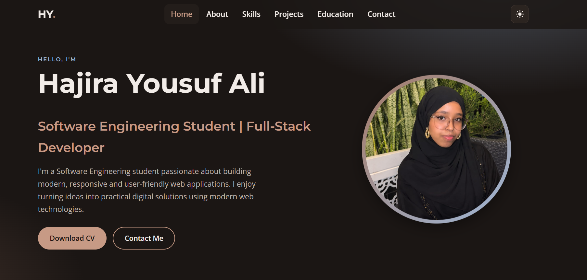
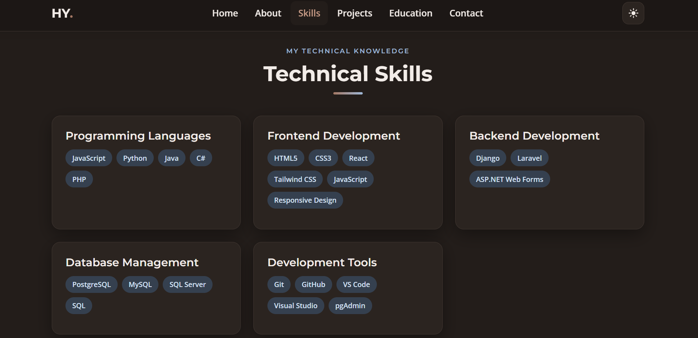
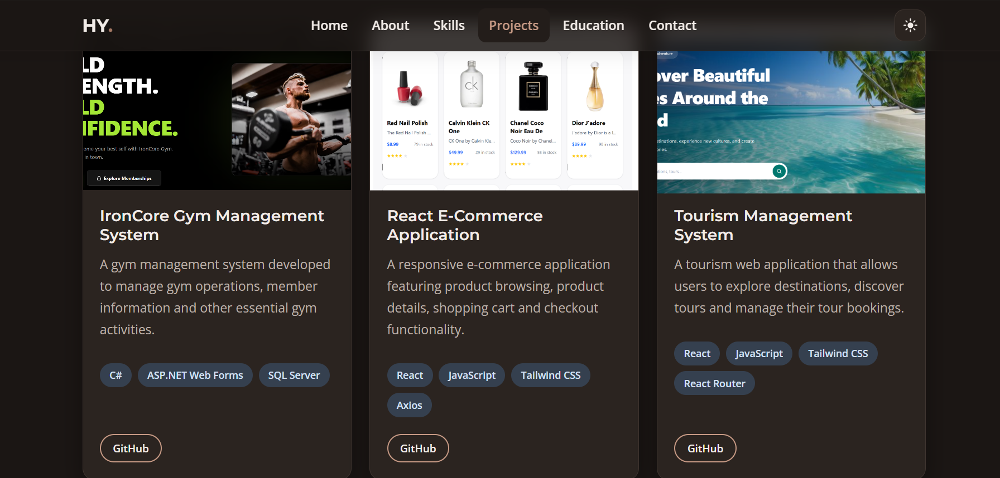
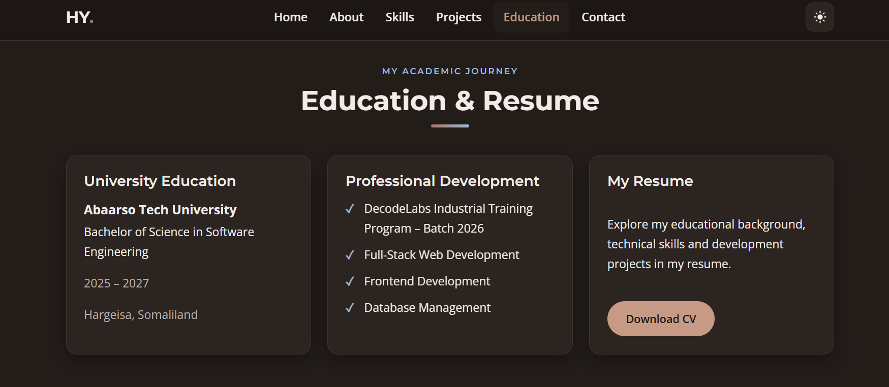

# ✨ My Personal Portfolio Website

A modern, responsive personal portfolio built with **HTML5, CSS3, and JavaScript (ES6+)** to showcase my skills, projects, education, and development journey.

**DecodeLabs – Project 1 | Batch 2026**

## 📸 Screenshots

| Home Page | Technical Skills |
|:---:|:---:|
|  |  |

| Projects | Education And Resume |
|:---:|:---:|
|  |  |

## 🚀 Features

- Modern and fully responsive design
- Dark and Light Mode
- Mobile-friendly navigation
- Smooth scrolling and active navigation links
- About Me and Technical Skills sections
- Featured Projects showcase
- Education and downloadable CV
- Contact form with JavaScript validation
- Accessible and keyboard-friendly interface

## 🛠️ Built With

- HTML5
- CSS3
- JavaScript (ES6+)
- CSS Grid & Flexbox
- Google Fonts – Montserrat & Open Sans

## 📂 Project Structure

```text
My-Personal-Portfolio-Website/
├── assets/
│   ├── screenshot-1.png
│   ├── screenshot-2.png
│   ├── screenshot-3.png
│   ├── screenshot-4.png
│   ├── avatar.svg
│   └── ...
├── css/
│   └── style.css
├── js/
│   └── script.js
├── index.html
└── README.md
```

## 🌐 Live Demo

[View My Portfolio](YOUR_LIVE_DEMO_LINK)

## 👩‍💻 About Me

**Hajira Yousuf Ali**  
Software Engineering Student | Full-Stack Developer  
📍 Hargeisa, Somaliland

I enjoy creating modern web applications, exploring new technologies, and turning ideas into practical digital solutions.

## 📬 Connect With Me

- **GitHub:** [HajiraYousuf](https://github.com/HajiraYousuf)
- **LinkedIn:** [Hajira Yousuf](https://www.linkedin.com/in/hajira-yousuf/)
- **Email:** hajirayousuf180@gmail.com

---

⭐ *Designed and developed with passion by Hajira Yousuf Ali.*
